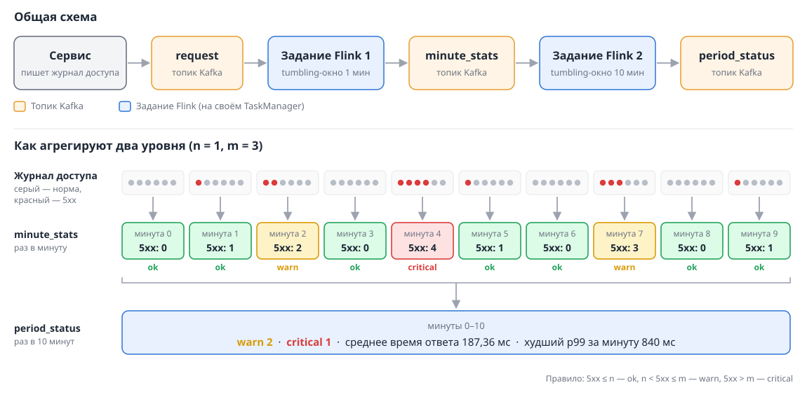

# Двухуровневые окна: мониторинг и алерты

## 1. Обзор

Новая топология — **двухуровневые окна**: данные сначала агрегируются в коротком временном окне, затем результаты агрегируются ещё раз в длинном окне. Оба уровня выполняют два независимых задания Flink, данные между ними передаются через Kafka.



## 2. Сценарий

Сценарий — **мониторинг и алерты**: сервис на каждый обработанный запрос пишет строку журнала доступа (access log) с метаданными запроса (поля — в разделе 4.1).

Дежурного инженера интересуют два вопроса, по одному на каждый уровень:

1. **В каком состоянии сервис в эту минуту**: сколько раз встретился каждый код ответа, каковы среднее время ответа, p95 и p99. Первый уровень, выход `minute_stats`.
2. **Нужен ли алерт за последние 10 минут**: сколько минут было в состоянии warn, сколько в critical, насколько медленной была самая медленная минута. Второй уровень, выход `period_status`.

Так устроено большинство реальных систем мониторинга: короткие окна собирают метрики, длинные окна принимают решение.

## 3. Значение для эксперимента

- **Зачем проверять два уровня вместе**: Flink гарантирует exactly-once только для одного задания. В цепочке второй уровень читает настоящий транзакционный выход первого, а отказ первого уровня может остановить второй. Мы проверяем, остаётся ли результат правильным при соединении двух заданий E1, и измеряем, сколько задержки добавляет такое соединение.
- **Сценарий мониторинга**: ошибка проявляется прямо как ложный или пропущенный алерт, последствия наглядны.
- **Выбор метрик**: накопительная (число кодов ответа), отношение (среднее время ответа), пороговая (warn / critical) и максимум (худший p99) по-разному реагируют на повтор и потерю. При одном и том же отказе одни метрики явно искажаются, другие не меняются совсем.
- **Поля отслеживания**: `request_ids` и `minute_windows` позволяют проверить каждый запрос — не потерян ли он, не учтён ли дважды, не попал ли в чужое окно. По одним агрегированным числам этого не видно.

## 4. Форматы сообщений

### 4.1 request (журнал доступа)

```json
{"id": 17, "timestamp": "2026-01-01T00:01:05.000", "error_code": 503, "response_time": 230}
```

| Поле | Значение |
|---|---|
| `id` | Номер запроса, уникален для каждого запроса. |
| `timestamp` | Время запроса; определяет, в какое окно он попадает. |
| `error_code` | Код ответа; 5xx (≥ 500) считается ошибкой. |
| `response_time` | Время ответа, мс. |

### 4.2 minute_stats (состояние сервиса за минуту)

```json
{"window_start": 60000, "status_counts": {"200": 5, "404": 1, "500": 1, "503": 1},
 "avg_response_time": 191.25, "p95_response_time": 420, "p99_response_time": 610,
 "response_time_sum": 1530, "request_ids": [12, 15, 17, 20, 23, 31, 40, 44]}
```

| Поле | Значение |
|---|---|
| `window_start` | Начало минуты. |
| `status_counts` | Сколько раз за минуту встретился каждый код ответа; сумма по 5xx — число ошибок. |
| `avg_response_time` | Среднее время ответа за минуту (число с плавающей точкой), равно `response_time_sum` ÷ число запросов. |
| `p95_response_time` | p95 времени ответа за минуту. |
| `p99_response_time` | p99 времени ответа за минуту. |
| `response_time_sum` | Сумма времени ответа за минуту; нужна второму уровню для среднего за 10 минут. |
| `request_ids` | Какие запросы вошли в минуту; длина списка — число запросов. |

Перцентили считаются методом nearest-rank: времена ответа сортируются по возрастанию, берётся ⌈p × N⌉-е значение.

### 4.3 period_status (состояние алерта за 10 минут)

```json
{"window_start": 0, "warn": 2, "critical": 1,
 "avg_response_time": 187.36, "max_p99_response_time": 840,
 "minute_windows": [0, 60000, 120000, 180000, 240000, 300000, 360000, 420000, 480000, 540000]}
```

| Поле | Значение |
|---|---|
| `window_start` | Начало 10-минутного периода. |
| `warn` | Число минут, в которых n < число ошибок ≤ m. |
| `critical` | Число минут, в которых число ошибок > m. |
| `avg_response_time` | Среднее время ответа за 10 минут (число с плавающей точкой): сумма `response_time_sum` всех минут ÷ сумма числа запросов всех минут. |
| `max_p99_response_time` | p99 самой медленной минуты за 10 минут. |
| `minute_windows` | Из каких записей `minute_stats` собран результат, с повторами. |

Число ошибок — количество запросов с кодом 5xx за минуту; n и m — пороги алерта.
